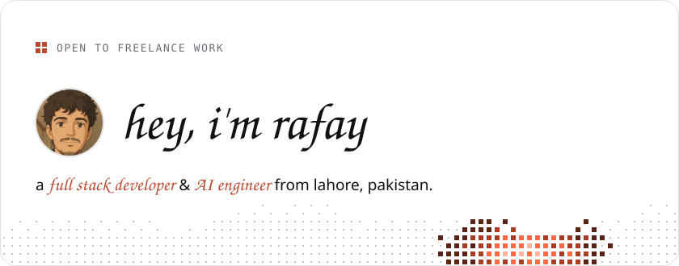
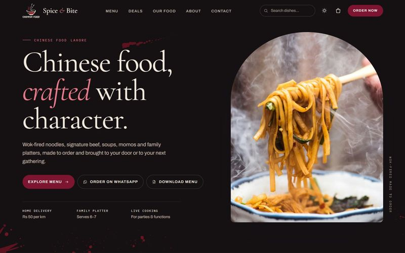
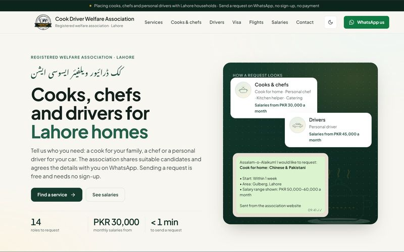
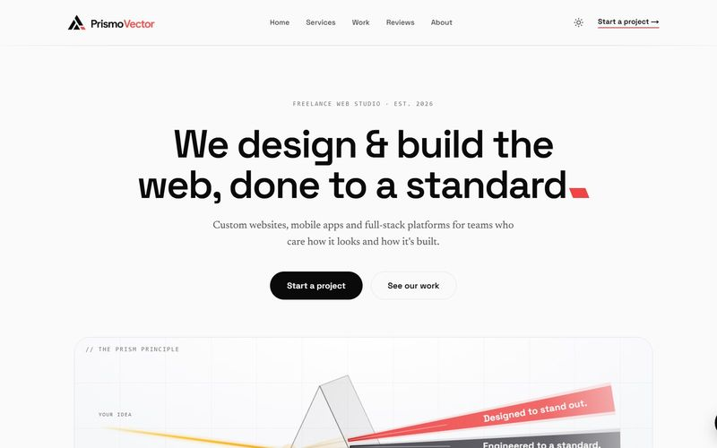
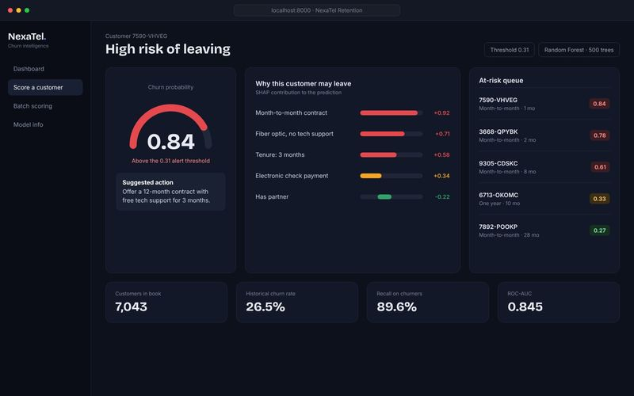
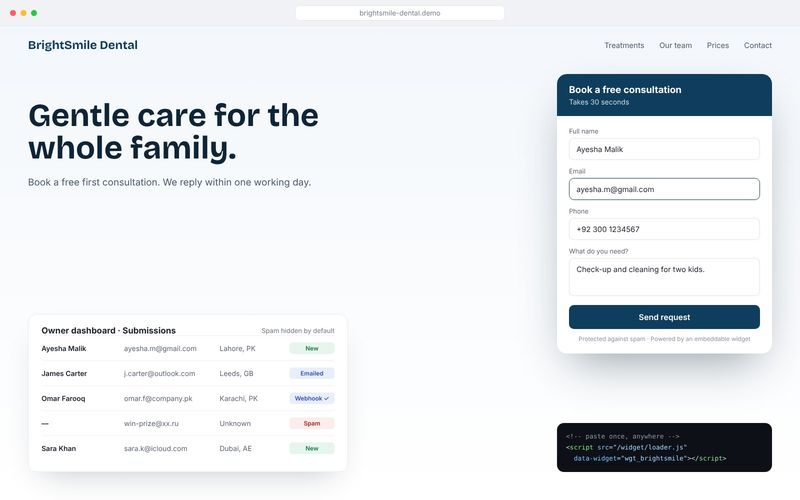
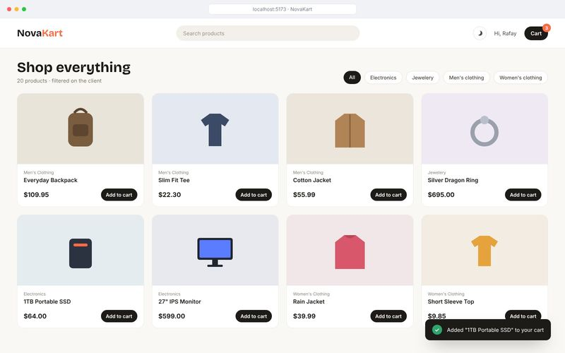

<a href="https://muhammadabdulrafay-sage.vercel.app">
  <picture>
    <source media="(prefers-color-scheme: dark)" srcset="assets/header-dark.svg">
    
  </picture>
</a>

 

<picture>
  <source media="(prefers-color-scheme: dark)" srcset="assets/h-about-dark.svg">
  
</picture>

I'm a software engineering student at **ITU Lahore** who builds web apps **end to end**: the interface, the API, the database, and lately the **AI agents** behind them. I freelance for small businesses (ordering sites, booking flows and AI chat), and I stay on after launch to keep them running.

If you have a problem a good web app could solve, [say hi](mailto:rafaykhan99999@gmail.com).

<picture>
  <source media="(prefers-color-scheme: dark)" srcset="assets/h-now-dark.svg">
  
</picture>

| | Role | When |
|---|---|---|
| **[Afrium](https://www.afrium.agency)** | AI Native Developer (part-time, remote). Building a multi-agent system that follows Pakistani news sources, merges duplicate stories, flags media bias and writes a daily report. | Aug&nbsp;2026&nbsp;–&#8288;&nbsp;now |
| **[Upwork](https://www.upwork.com/freelancers/~01fd358d4c55230178)** | Freelance full stack developer | Nov&nbsp;2026&nbsp;–&#8288;&nbsp;now |
| **[Dev Weekends](https://www.devweekends.com)** | FullStack AI Engineering Fellow | Jun&nbsp;2026&nbsp;–&#8288;&nbsp;now |
| **[FlyRank AI](https://internship.flyrank.ai)** | Backend AI Engineer Intern | Jul&nbsp;–&#8288;&nbsp;Sep&nbsp;2026 |
| **Zee Outsourcing Solutions** | Data Engineering Intern | Jun&nbsp;–&#8288;&nbsp;Aug&nbsp;2026 |
| **[ITU Lahore](https://itu.edu.pk)** | BS Software Engineering | 2024&nbsp;–&#8288;&nbsp;2028 |

<picture>
  <source media="(prefers-color-scheme: dark)" srcset="assets/h-built-dark.svg">
  
</picture>

<table>
<tr>
<td width="50%" valign="top">

 <b>Spice &amp; Bite</b> · client 
Online menu, deals and WhatsApp ordering for a restaurant in Lahore, with an admin panel for the menu, orders and printed slips. 
Vite · JavaScript · Supabase · <a href="https://spiceandbite.store">live ↗</a>
</td>
<td width="50%" valign="top">

 <b>Cook Driver Welfare Association</b> · client 
Families request a cook or a driver in under a minute over WhatsApp, with no sign-up. Mobile-first, with automated tests and CI. 
Supabase · GitHub Actions · <a href="https://cookdrivewelfare.com">live ↗</a>
</td>
</tr>
<tr>
<td width="50%" valign="top">

 <b>PrismoVector</b> · own product 
A Next.js platform with dark and light themes and an AI chat assistant backed by a FastAPI, Qdrant and Ollama agent. 
Next.js · FastAPI · Qdrant · <a href="https://www.prismovector.com">live ↗</a>
</td>
<td width="50%" valign="top">

 <b>NexaTel Churn Intelligence</b> · ML 
Predicts which telecom customers are about to leave and explains why with SHAP. 89.6% recall, 0.845 ROC-AUC, served as a Dockerized FastAPI tool. 
FastAPI · scikit-learn · <a href="https://github.com/rafayykhan/nexatel-churn-intelligence">code ↗</a>
</td>
</tr>
<tr>
<td width="50%" valign="top">

 <b>Lead-capture widget platform</b> · backend 
Paste one script tag; the backend handles validation, rate limiting, spam checks, background emails and webhooks. My FlyRank capstone, 69 tests. 
Python · PostgreSQL · Redis · Celery · <a href="https://github.com/rafayykhan/flyrank-capstone-widget-platform">code ↗</a>
</td>
<td width="50%" valign="top">

 <b>NovaKart</b> · frontend 
A React storefront built to practise state management: Redux Toolkit for cart, auth and products, and a login-protected checkout. 
React 19 · Redux Toolkit · Tailwind · <a href="https://github.com/rafayykhan/novakart">code ↗</a>
</td>
</tr>
</table>

More on my portfolio: **[muhammadabdulrafay-sage.vercel.app/projects](https://muhammadabdulrafay-sage.vercel.app/projects)** →

<picture>
  <source media="(prefers-color-scheme: dark)" srcset="assets/h-stack-dark.svg">
  
</picture>

<table>
<tr><td><b>Front</b></td><td>React · Next.js · Vite · Tailwind CSS</td></tr>
<tr><td><b>Back</b></td><td>Node.js · Express · Python · Django · FastAPI</td></tr>
<tr><td><b>Data</b></td><td>PostgreSQL · MongoDB · Supabase · Redis</td></tr>
<tr><td><b>Ship</b></td><td>Docker · AWS · GitHub Actions</td></tr>
<tr><td><b>AI</b></td><td>LangGraph · LangChain · Qdrant · RAG</td></tr>
</table>

<picture>
  <source media="(prefers-color-scheme: dark)" srcset="assets/h-elsewhere-dark.svg">
  
</picture>

[Portfolio](https://muhammadabdulrafay-sage.vercel.app) · [LinkedIn](https://www.linkedin.com/in/muhammad-abdul-rafayy/) · [Medium](https://rafayykhan.medium.com) · [Upwork](https://www.upwork.com/freelancers/~01fd358d4c55230178) · [Email](mailto:rafaykhan99999@gmail.com)

Latest writing: [I Almost Skipped Vanilla JavaScript to Jump Straight Into React. Here's Why I'm Glad I Didn't](https://javascript.plainenglish.io/i-almost-skipped-vanilla-javascript-to-jump-straight-into-react-heres-why-i-m-glad-i-didn-t-d95137f6380c)

<picture>
  <source media="(prefers-color-scheme: dark)" srcset="assets/footer-dark.svg">
  
</picture>

<!-- Graphics are generated by scripts/build.mjs (node scripts/build.mjs). Fonts: SIL OFL, see fonts/. -->
